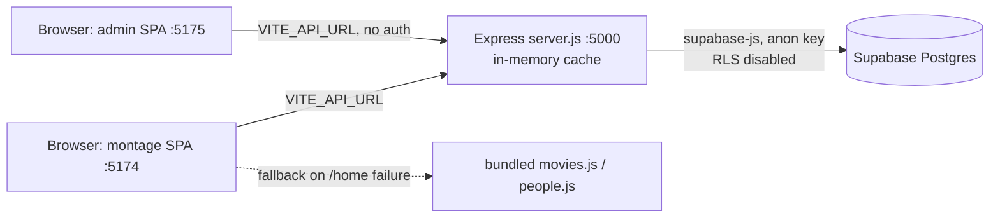
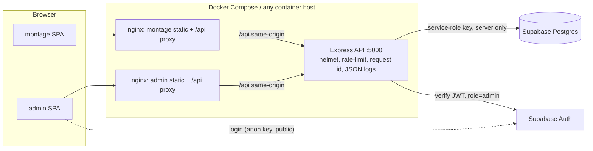
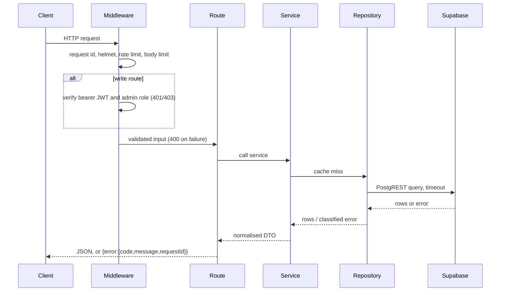

# MovieDB Architecture

## 1. Current (pre-2.0) topology



Problems this topology has are listed in `PROJECT_AUDIT.md`.

## 2. Target (2.0) topology



Rules:
- Browsers only talk to their own origin (`/api/...`); the web container proxies to `backend:5000` over the internal network, so no Docker hostname reaches a browser and no CORS is needed in production.
- The service-role key exists only in the backend container environment. Frontends receive only the public Supabase URL and anon key (admin login only).
- Backend is the sole database gateway, so RLS can be enabled with no public policies (migration provided, not auto-applied).

## 3. Backend modules

```
backend/server.js            entry: config -> app -> listen, graceful shutdown
backend/src/config.js        env parsing + validation (actionable errors, no secrets)
backend/src/logger.js        JSON logger
backend/src/errors.js        AppError + database error classification
backend/src/cache.js         TTL cache with tag-free explicit invalidation
backend/src/db/client.js     supabase client with request timeout; diagnose()
backend/src/db/repository.js every query in one place
backend/src/services/        normalisation, home rows, recommendations
backend/src/middleware/      request id, auth, validation, errors
backend/src/routes/          health, public catalog, admin writes
backend/test/                node:test suites with a fake repository
```

## 4. Request lifecycle



## 5. Health model

| Endpoint | Meaning | Status |
|---|---|---|
| `GET /api/health/live` | process is up | always 200 |
| `GET /api/health/ready` | config valid and database answers a query | 200 or 503 |
| `GET /api/health` | detailed, includes `checks.database.{status,latencyMs,category}` | 200 or 503 |

Database failure categories: `dns`, `tls`, `timeout`, `connection`, `auth`, `schema`, `unknown`. Messages never include keys.
